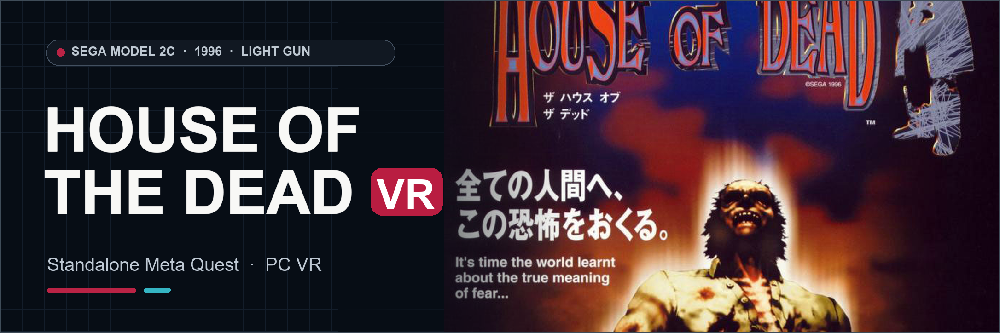

# The House of the Dead VR
### Sega Model 2C Arcade Light-Gun Horror · Standalone Meta Quest & PC VR

**[Download Quest, Windows OpenXR, source and checksums](https://github.com/vr4all-standalone/hotd-model2-vr/releases/tag/v0.1.8-beta)**

**[🌐 VR4ALL — Standalone VR Mod Installer](https://github.com/vr4all-standalone/vr4all-standalone)**  
**[☕ Donate to VR4ALL](https://ko-fi.com/vr4all)**

## v0.1.8-beta

- Gun, World, System and In-game settings tabs with Advanced pages. In-game opens native Service.
- One controller owns the settings pointer. A contact dot marks its hit. Laser offers Off, Normal, 5x and 10x.
- Either hand can Start solo play. The free trigger can take over after releasing the active trigger. Start on the free hand joins P2, then the saved layout takes over.
- How to Play uses Start and Fire, with an inward trigger callout.
- Crosshair defaults are 22% minimum, 60% maximum and 6.7 m shrink distance. The reload button works with both Shoot off-screen and Point off-screen.

Requires your own original arcade game files. Includes standalone Quest and Windows OpenXR builds.

---

## The port

This is the **original arcade The House of the Dead**, not The House of the Dead 2. The independent Model 2C port uses the original game's geometry, enemies, audio and game logic while adding stereo VR, head tracking and tracked lightguns. Standalone Quest 3/3S and Windows OpenXR builds are available in the release.

The initial Quest 3S build has been played. Development work has since improved the cabinet sensor strobe, original pistol presentation, view framing and settings. The latest beta's physical feel and performance still need play testing.

## Your game files

Bring your own **original `hotdo` revision**. Setup accepts `hotdo.zip`, or a legacy `hotd.zip` only when its 29 verified payloads match that original revision. The later MAME `hotd` Revision A is a different set. No game data is included here or in future software packages.

## Install

Use [VR4ALL](https://github.com/vr4all-standalone/vr4all-standalone/releases) to choose your owned original-revision `hotdo.zip`, download this port's Quest APK and copy the game file to `/sdcard/Download/hotdo.zip`. Open **The House of the Dead - VR4ALL** and finish its ROM validation. A legacy archive named `hotd.zip` works only when it contains the same original-revision payloads. For Windows OpenXR, extract the PCVR ZIP, put your owned archive in its `roms` folder, and run `run-pcvr.cmd`.

## Development notes

The Quest app name is **The House of the Dead - VR4ALL**. This port has its own package and settings; it does not replace The House of the Dead 2. The arcade emulation and VR port are experimental. Quest 3S play has been observed on a preceding build; the final beta build and Windows OpenXR package have software checks but still need physical play checks. This is an independent fan project, not affiliated with Sega or Meta.

[Original flyer and banner attribution](docs/github/ARTWORK.md)
